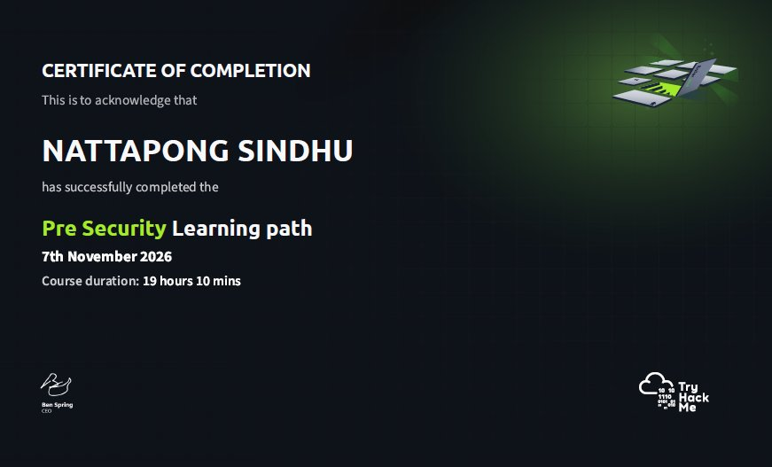
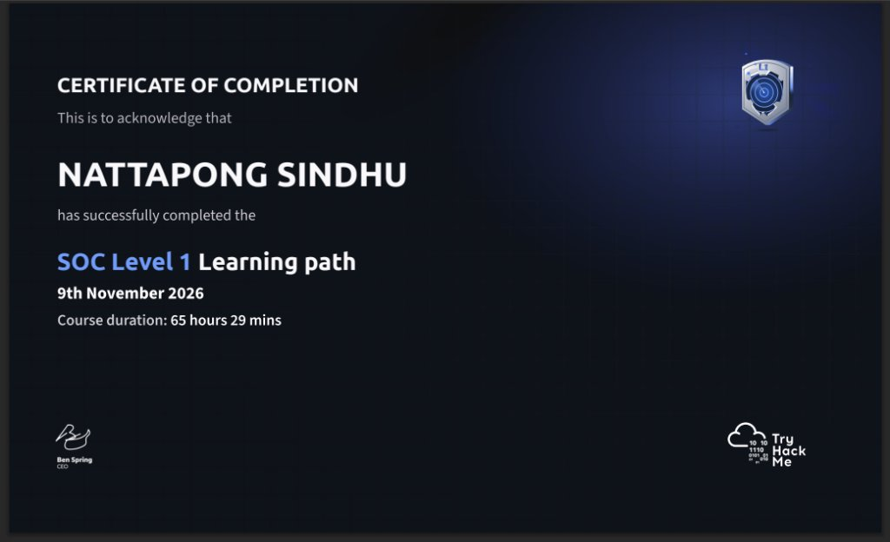

# 7. Certificates & Links

## Certificates

Both certificates were issued by TryHackMe on completion of the corresponding learning path.

### TryHackMe Pre-Security — Certificate of Completion

| Field | Value |
| :--- | :--- |
| Path | Pre-Security |
| Modules / labs | 7 modules · 31 hands-on labs |
| Course time on platform | 19 hrs 10 mins |
| Issued to | Nattapong Sindhu |

### TryHackMe SOC Level 1 — Certificate of Completion

| Field | Value |
| :--- | :--- |
| Path | SOC Level 1 |
| Modules / labs | 14 modules · 68 hands-on labs |
| Course time on platform | 65 hrs 29 mins |
| Issued to | Nattapong Sindhu |

> Verification: the certificates carry the platform's own identifiers. If you need a live check, the
> TryHackMe profile below is the authoritative source — the certificates here are copies, the profile
> is the record.

## Links

| Where | Link |
| :--- | :--- |
| TryHackMe profile | [tryhackme.com/p/nattapongsindhu](https://tryhackme.com/p/nattapongsindhu) |
| GitHub profile | [github.com/nattapongsindhu](https://github.com/nattapongsindhu) |
| This portfolio's entry point | [README](README.md) |

## What the certificates do and do not say

They say the paths were completed. They do not say how well someone investigates an alert at 02:00
with incomplete information. That is what [Practical Evidence](06-practical-evidence/README.md)
and [Study Notes](05-study-notes/README.md) are for.
