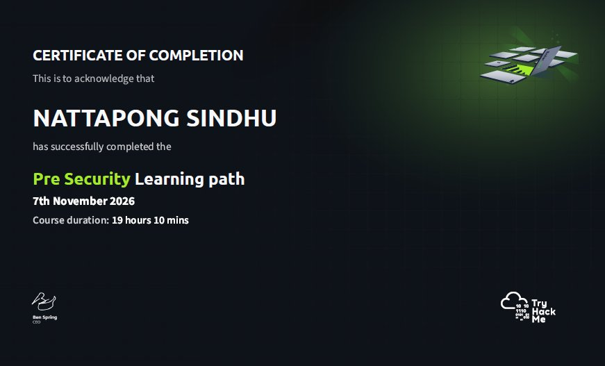
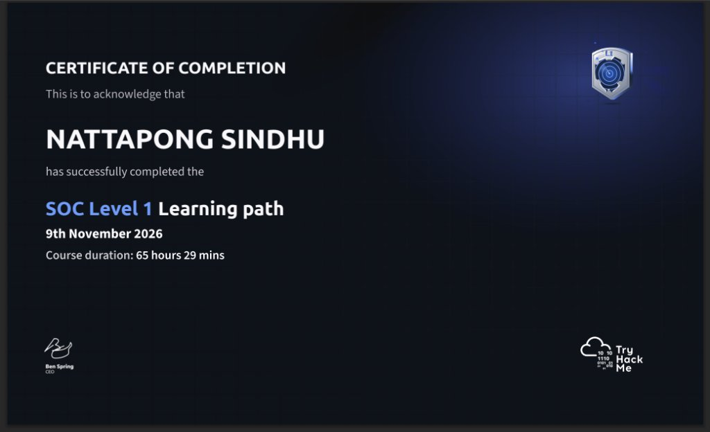

# TryHackMe IT Cybersecurity Portfolio


A study portfolio built from the TryHackMe Pre-Security and SOC Level 1 paths. This repository
documents how I learned blue-team work: what I studied, what I practised, what I built, and what I
would do next.

|  |  |
| :--- | :--- |
| **Status** | Both paths complete — 21 modules · 99 hands-on labs · 6 investigations written · 2 certificates · 2 tools built |
| **Platform** | [TryHackMe](https://tryhackme.com/) — profile [gnopattan](https://tryhackme.com/p/gnopattan) |
| **Period** | November – December 2026 |

**Sister portfolio:** [LetsDefend study portfolio](https://github.com/nattapongsindhu/LetsDefend-IT-Cybersecurity-Portfolio)

---

## 1. About This Repository

I built this repository for two reasons.

**First, to show the work.** Anyone can list "SOC Analyst" on a CV. I wanted a place where a recruiter
or a hiring manager can see what I actually did: the paths I finished, the concepts I can explain in my
own words, the investigations I worked end to end, and the tooling I wrote along the way.

**Second, to keep an honest record.** For every topic I note what I now understand and what I still do
not. Where a lab could not give me something — endpoint isolation, for example — that is written down
instead of hidden.

### What this repository is not

- It is **not** a walkthrough dump. There are no flags, no room answers, and no copy-paste solutions.
- It is **not** a certificate wall. The certificates page links to a real profile; the value is in the
  evidence behind them.
- It is **not** finished. The "Next Steps" section is part of the point.

### Who this is for

Recruiters and hiring managers looking at entry-level SOC, blue-team, or IT security roles, and anyone
who wants to see how a self-directed learner documents work.

---

## 2. Learning Paths Completed

### TryHackMe — two paths

| Item | Detail |
| :--- | :--- |
| Paths | Pre-Security · SOC Level 1 |
| Modules | **21** (7 + 14) |
| Hands-on labs | **99** (31 + 68) |
| Course time on platform | 19 hrs 10 mins · 65 hrs 29 mins |
| Certificates | **2** (both paths) |
| Period | November – December 2026 |
| Status | **Complete** |

Pre-Security supplied the vocabulary: how a network is described, what an operating system is doing,
how the web actually works. SOC Level 1 supplied the job: alert triage, traffic analysis, endpoint and
log monitoring, threat intelligence, and a capstone investigation.

Module-by-module detail and the concept notes are in [Study Notes](study-notes/README.md). The full
room list — 105 rooms across the 21 modules — is in [Room Map](ROOM-MAP.md).
Certificates are in [`certificates/`](certificates/).

### Related study (sister repository)

| Path | Platform | Status |
| :--- | :--- | :--- |
| SOC Analyst Learning Path | LetsDefend | Completed — 25 modules |

Write-ups for that path live in the
[LetsDefend portfolio](https://github.com/nattapongsindhu/LetsDefend-IT-Cybersecurity-Portfolio), so
this repository stays focused on the TryHackMe work.

---

## 3. Skills Learned

| Skill | Where it came from | What I can do with it |
| :--- | :--- | :--- |
| Networking | Pre-Security, traffic analysis modules | Read a capture and explain a conversation: handshake, HTTP, DNS, TLS |
| Linux | Pre-Security, Linux security monitoring | Work a shell, read auth logs, explain what a SUID or cron misconfiguration looks like |
| Security fundamentals | Cyber Defence Frameworks | Apply Pyramid of Pain, Kill Chain and MITRE ATT&CK and say why an indicator is cheap or expensive |
| SOC operations | SOC team internals, SIEM triage | Triage an alert, decide true/false positive, write the close-out note |
| Log analysis | Windows / Linux / web monitoring, Splunk | Correlate process, network and identity evidence into one timeline |
| Incident response | DFIR modules, endpoint investigation | Scope, contain, preserve, eradicate, recover, document |
| Detection engineering | NIDS modules, Snort and Zeek | Write a rule, state its false-positive case, tune it without blinding it |
| Phishing analysis | Phishing analysis module | Read headers, judge an attachment, decide the user-facing question |
| Documentation | 6 investigation write-ups | Turn an investigation into a report a manager can read |
| Python | The log analyzer in this repository | Write a small tool that removes repetitive triage work |

### What I am not claiming

I have not worked in a production SOC. The cases here are platform labs and simulated incidents. My
endpoint isolation actions were recommendations in reports, not executed steps, because the lab had no
isolation controls. I say this because a portfolio that overstates its evidence is worse than a smaller
honest one.

---

## 4. Tools and Technologies

| Area | Tools I practised with |
| :--- | :--- |
| Network analysis | Wireshark, TShark, tcpdump, display filters, stream reconstruction |
| Reconnaissance and scanning | Nmap, service and version detection |
| Detection | Snort, Zeek, rule writing and tuning |
| Log and SIEM | Splunk (SPL: `stats`, `eval`, `table`, `where`), dashboards, alerts |
| Endpoint | Windows Event Viewer, Sysmon, Sysinternals (Procmon, Autoruns), Volatility, Autopsy |
| Systems | Linux command line, Bash, Windows 10/11, virtual lab machines |
| Scripting | Python 3 (log parsing, pattern matching), Bash |
| Documentation | Markdown, Git and GitHub, MITRE ATT&CK mapping |

### Python

I built two small tools as practical evidence, both standard library only:

- [Python Log Analyzer](practical-evidence/python-log-analyzer/) — parses a web access log, counts
  sources, spots scanner user agents, and surfaces injection-style payloads.
- [Zeek conn.log summariser](practical-evidence/zeek-conn-summary/) — turns a Zeek `conn.log` into the
  six views I actually use first: volume, top talkers, top destinations, long connections, large
  transfers, uncommon ports.

Both READMEs explain the design decisions, including the bugs that taught me the most. Both tools have
regression tests in [`tests/`](tests/) that run in CI (`.github/workflows/tests.yml`) on Python 3.10,
3.11 and 3.12, and the full sample output of each tool is committed next to it for diffing.

---

## 5. Study Notes

My own summaries, in my own words, of the concepts behind each block of the paths. These are
explanations, not walkthroughs — no room answers, no flags, no step-by-step solutions to anything still
active.

| Note | Covers |
| :--- | :--- |
| [01 — Networking and traffic](study-notes/01-networking-and-traffic.md) | Conversations, ports, DNS, segmentation, what packets can and cannot prove |
| [02 — Linux fundamentals](study-notes/02-linux-fundamentals.md) | Permissions, SUID, log locations, read-only triage habits |
| [03 — Security fundamentals and MITRE ATT&CK](study-notes/03-security-fundamentals-and-mitre.md) | Prevention vs detection, Pyramid of Pain, tactics vs techniques |
| [04 — SOC operations and phishing](study-notes/04-soc-operations-and-phishing.md) | Triage decisions, scoping, close-out notes, header analysis |
| [05 — Log analysis](study-notes/05-log-analysis.md) | Windows event IDs, Sysmon, web logs, timeline building |
| [06 — Incident response and detection engineering](study-notes/06-incident-response-and-detection.md) | Containment order, evidence handling, rules that hold |

---

## 6. Practical Evidence

Work I produced myself. Each item is an evidence summary: what the case was, what I did, what the result
was, and what I could not verify.

| # | Evidence | Type | Result |
| :---: | :--- | :--- | :--- |
| 01 | [Network traffic analysis](practical-evidence/01-network-traffic-analysis.md) | Packet capture lab | Multi-stage exchange reconstructed from a PCAP |
| 02 | [SIEM alert investigation](practical-evidence/02-siem-alert-investigation.md) | Alert triage | True positive: impersonated account to C2 stager |
| 03 | [Windows endpoint investigation](practical-evidence/03-windows-endpoint-investigation.md) | Endpoint / DFIR | Document handler to privilege escalation, fully traced |
| 04 | [NIDS rule analysis](practical-evidence/04-nids-rule-analysis.md) | Detection engineering | Rule changes with the false-positive trade-off written down |
| 05 | [Linux privilege escalation](practical-evidence/05-linux-privilege-escalation.md) | Red team | Two independent paths to root, both remediated |
| 06 | [Windows SMB exploitation](practical-evidence/06-windows-smb-exploitation.md) | Red team | Unpatched SMB on an end-of-life host, weak credentials |
| 07 | [Python log analyzer](practical-evidence/python-log-analyzer/) | Tool I built | Parses access logs, flags scanners and injection payloads |
| 08 | [Zeek conn.log summariser](practical-evidence/zeek-conn-summary/) | Tool I built | Top talkers, long connections, large transfers, uncommon ports |

Every case links back to a full report held in my private working repository. If you are reviewing my
application and want the long version, ask and I will send it.

---

## 7. Certificates and Links

| Item | Link |
| :--- | :--- |
| TryHackMe profile | [gnopattan](https://tryhackme.com/p/gnopattan) |
| GitHub | [github.com/nattapongsindhu](https://github.com/nattapongsindhu) |



*Pre-Security Learning Path — 7 modules, 31 labs, 19 hrs 10 mins — issued 7 November 2026.*



*SOC Level 1 Learning Path — 14 modules, 68 labs, 65 hrs 29 mins — issued 9 November 2026.*

Both certificate images are stored in [`certificates/`](certificates/README.md). They are copies of
certificates issued by TryHackMe; the live record is the profile above.

---

## 8. Lessons Learned

**The alert is a question, not an answer.** My first instinct used to be "is this malicious?". The more
useful question is "what decision does this alert need, and what evidence would change my mind?". That
reframing cut my triage time and made close-out notes shorter.

**Scope is the difference between a ticket and an incident.** A single suspicious process is a ticket.
The same process on three hosts, started by the same parent, is an incident. Asking "where else would
this appear?" is usually one query, and it has to happen before the verdict.

**Evidence has a half-life.** Volatile state disappears the moment you reboot or clean. Capturing
process lists, connections and scheduled tasks first is the difference between explaining an incident
and being unable to prove it.

**Writing is part of the investigation.** Twice I found a gap in my own reasoning only while writing the
timeline. If the finding cannot be stated in one sentence, the analysis is not finished.

**Knowing the attacker's side made me a better defender.** The two boot2root machines were the most
uncomfortable part of the sprint and the most instructive. A misconfigured SUID binary or an unpatched
SMB service turns into full control faster than expected, which changed how I rank findings: by "what
does this give an attacker next", not by severity score alone.

**Say what you could not check.** Every summary here has a limits section. It is the part I am most
comfortable defending in an interview, because it is the part that is honest.

---

## 9. Next Steps

| Priority | Goal | Why |
| :---: | :--- | :--- |
| 1 | Linux depth: systemd, auditd, hardening | Half of incident response happens on the command line |
| 2 | Grow the Python analyser into a real triage tool | Turn a learning exercise into something I would actually use |
| 3 | Network security: segmented lab with firewall and IDS | Practise detection on traffic I built and understand |
| 4 | SIEM breadth: second stack (Elastic or Wazuh) | Prove the concepts are not tool-specific |
| 5 | Detection engineering: Sigma rules | Write durable rules instead of describing them |
| 6 | CompTIA Security+ | Structured coverage for HR screening |

Longer term I want to specialise in detection and response, with enough engineering skill to automate
the boring parts.

---

## 10. Security and Privacy Check

This repository is public, so it was checked before publishing:

| Check | Status |
| :--- | :--- |
| API keys | None present |
| Passwords or tokens | None present |
| Flags or room answers | None present — study notes are concept summaries only |
| Active-room walkthroughs | None present |
| Personal data (addresses, phone numbers, other people's names) | None present |
| Internal or employer data | None present — all cases are public lab data |
| Lab hostnames and IPs | Only public documentation ranges (192.0.2.0/24, 198.51.100.0/24, 203.0.113.0/24) and private test ranges |

The full checklist and the commands used to scan for secrets are in
[SECURITY-CHECK.md](SECURITY-CHECK.md).

---

## Repository layout

```text
TryHackMe-IT-Cybersecurity-Portfolio/
├── README.md                    this page
├── ROOM-MAP.md                  every room on the two paths (105), and where its evidence lives
├── study-notes/                 concept summaries in my own words (6 notes)
├── practical-evidence/          six case summaries + two Python tools
├── certificates/                certificate images and credential links
├── tests/                       regression tests for both tools
├── .github/workflows/tests.yml  CI: runs the tests on every push
└── SECURITY-CHECK.md            the pre-publish safety checklist
```

---

## Note on sources

Everything here is my own writing. The learning content comes from the TryHackMe platform; the
summaries, the analysis, the mistakes and the conclusions are mine. Where a lab could not provide
something — endpoint isolation telemetry, for instance — the evidence summary says so rather than
implying otherwise.

---

## License

| Part | License |
| :--- | :--- |
| Code (the Python log analyzer) | **MIT** — see [LICENSE](LICENSE). Use it, change it, ship it. |
| Written content (notes, evidence summaries, this README) | © Nattapong Sindhu. Quote it with attribution; do not republish it as your own. |
| Platform content quoted for context | Belongs to TryHackMe / LetsDefend; used here only as short references |

If you are a recruiter or an interviewer, you do not need permission to read, print or share a link to
this repository. That is what it is for.
