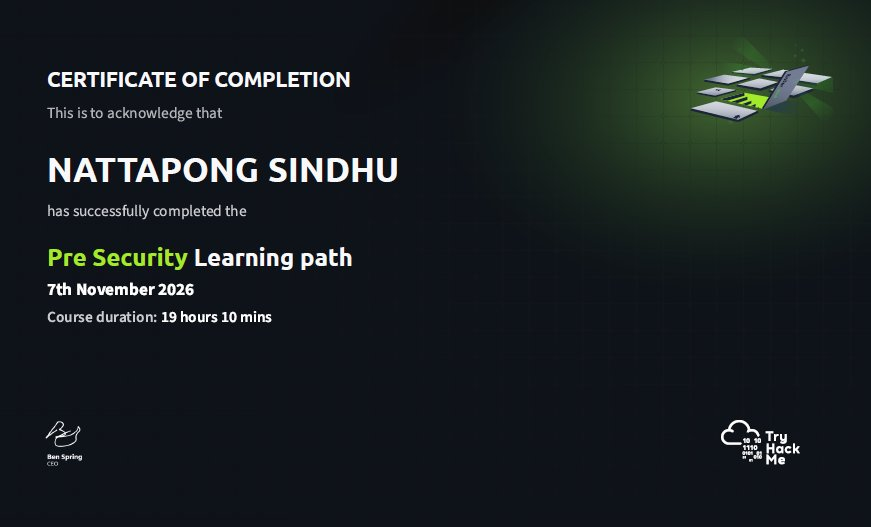
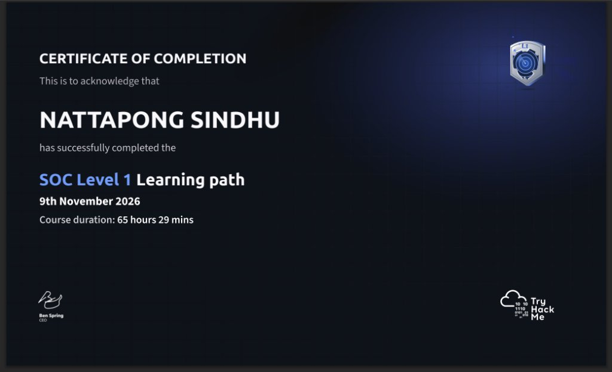

# Certificates

Two certificates, both issued by TryHackMe on completion of the corresponding learning path.

| Certificate | Path | Issued | Modules / labs | Course time | File |
| :--- | :--- | :--- | :---: | ---: | :--- |
| Pre-Security | Pre-Security Learning Path | 7 November 2026 | 7 / 31 | 19 hrs 10 mins | [`pre-security-certificate.jpg`](pre-security-certificate.jpg) |
| SOC Level 1 | SOC Level 1 Learning Path | 9 November 2026 | 14 / 68 | 65 hrs 29 mins | [`soc-level-1-certificate.jpg`](soc-level-1-certificate.jpg) |

## Pre-Security — Certificate of Completion

## SOC Level 1 — Certificate of Completion

## Verification

The images above are copies. The authoritative record is the platform profile:

- TryHackMe profile: **[tryhackme.com/p/gnopattan](https://tryhackme.com/p/gnopattan)**

## What the certificates do and do not say

They say both paths were completed. They do not say how someone investigates an alert at 02:00 with
half the evidence missing. That is what [Practical Evidence](../practical-evidence/README.md) is for.
